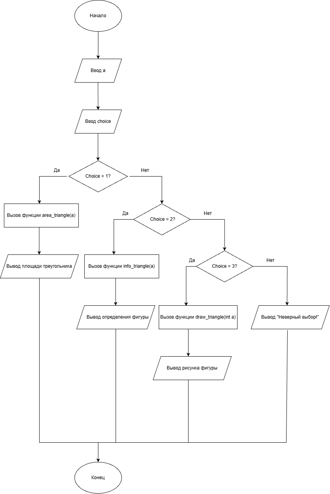

# Домашнее задание к работе 10

## Условие задачи

Для заданной пользователем фигуры (равносторонний треугольник) составить программу, которая предлагает меню выбора одной из операций: 1) рассчитать площадь; 2) вывести определение фигуры; 3) нарисовать фигуру. Для каждой операции реализовать отдельную функцию.

## 1. Алгоритм
### Алгоритм
```
1. Начало
2. Ввести сторону треугольника a
3. Вывести меню выбора операции
4. Ввести номер операции choice
5. Если choice == 1:
   -Вызвать функцию area_triangle(a) и вывести площадь
6. Если choice == 2:
   -Вызвать функцию info_triangle() и вывести определение
7. Если choice == 3:
   -Вызвать функцию draw_triangle(a) и нарисовать фигуру
8. Если choice другой: вывести сообщение об ошибке
9. Конец
```
### Блок-схема


## 2. Реализация программы
```
#define _CRT_SECURE_NO_WARNINGS
#include <stdio.h>
#include <locale.h>
#include <math.h>

float area_triangle(float a);
void info_triangle();
void draw_triangle(int a);

int main()
{
    setlocale(LC_ALL, "RUS");
    int choice;
    float a;

    printf("Введите сторону равностороннего треугольника (a): ");
    scanf("%f", &a);

    printf("\nВыберите операцию:\n");
    printf("1) Рассчитать площадь\n");
    printf("2) Вывести определение фигуры\n");
    printf("3) Нарисовать фигуру\n");
    scanf("%d", &choice);

    switch (choice)
    {
    case 1:
        printf("Площадь треугольника = %.2f\n", area_triangle(a));
        break;
    case 2:
        info_triangle();
        break;
    case 3:
        draw_triangle((int)a);
        break;
    default:
        printf("Неверный выбор!\n");
    }

    return 0;
}

float area_triangle(float a)
{
    return (sqrt(3.0) / 4.0) * a * a;
}

void info_triangle()
{
    printf("Равносторонний треугольник — это треугольник, у которого все стороны и углы равны.\n");
}

void draw_triangle(int a)
{
    for (int i = 1; i <= a; i++)
    {
        for (int j = 0; j < a - i; j++)
            printf(" ");
        for (int j = 0; j < 2 * i - 1; j++)
            printf("*");
        printf("\n");
    }
}
```
### 3. Результаты работы программы
```
Введите сторону равностороннего треугольника (a): 4

Выберите операцию:
1) Рассчитать площадь
2) Вывести определение фигуры
3) Нарисовать фигуру
Ваш выбор: 1
Площадь треугольника = 6.93

Введите сторону равностороннего треугольника (a): 5

Выберите операцию:
1) Рассчитать площадь
2) Вывести определение фигуры
3) Нарисовать фигуру
Ваш выбор: 2
Равносторонний треугольник — это треугольник, у которого все стороны и углы равны.
```
### 4. Информация о разработчике

Дегтярева Полина, бИЦТ-262
